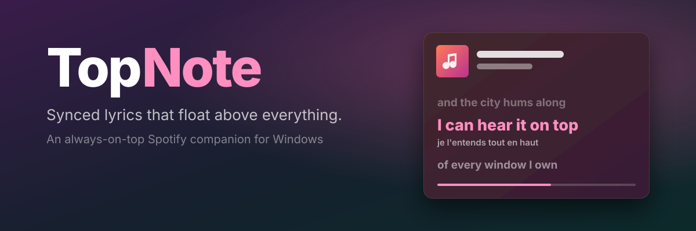

<p align="center">
  
</p>

<p align="center">
  <a href="https://github.com/imad-mahm/TopNote/releases/latest"><b>⬇ Download for Windows &amp; Linux</b></a>
  &nbsp;·&nbsp; <a href="#-features">Features</a>
  &nbsp;·&nbsp; <a href="#-linux">Linux</a>
  &nbsp;·&nbsp; <a href="#-setup-5-minutes-once">Setup</a>
  &nbsp;·&nbsp; <a href="#%EF%B8%8F-shortcuts--gestures">Shortcuts</a>
  &nbsp;·&nbsp; <a href="#-faq">FAQ</a>
</p>

---

**TopNote** is a tiny, always-on-top companion for Spotify on Windows and Linux. It floats over your browser, your IDE or your game and shows **live, synced lyrics** for whatever is playing. You can shrink it to a one-line strip, blow it up into a karaoke wall, or make it a see-through overlay that clicks pass straight through.

It's built around the lyrics: it pulls them from Spotify, Musixmatch or LRCLIB, can translate or romanize them, keeps your listening stats, and lives happily in a 220 × 90 px corner of your screen. It can even play your music when Spotify is closed. 🎤

> Built with **Tauri v2 + Rust + React**. The installer is ~4 MB and it uses barely any RAM, because it runs on the system's own web view (WebView2 on Windows, WebKitGTK on Linux) rather than a bundled Chromium.

## ✨ Features

### 🎶 Lyrics, from wherever they exist
- **Three sources with automatic fallback:** Spotify's own lyrics → Musixmatch (including **word-by-word** sync) → LRCLIB → plain text. You choose the order.
- **Karaoke-style word wipe** when the source has word timing.
- **Click any line to jump there.** Scroll freely, and it snaps back to the current line after a few seconds.
- **Translation and romanization** under every line: Japanese, Korean, Arabic, Russian and more, in 16 target languages. Results are cached, so each song is only translated once.
- **Per-song timing fix.** If one song's lyrics run 300 ms early, nudge them once and TopNote remembers the fix for that song.
- **Manual lyrics search** *(Advanced)*. When the auto-match picks the wrong song (live versions, remixes, covers), search and pick the right lyrics yourself. Your pick sticks.
- **Instant lyrics.** Lyrics for your whole queue are fetched in the background, so they're ready before the song starts.

### 🪟 A window that behaves
- **Always on top, for real.** It re-asserts itself above fullscreen-borderless games and video players. Click the pin in the top-left corner to unpin it.
- **Resize it to anything.** The layout adapts: a one-line *strip*, a *compact* square, a *wide* side-by-side view, or a *tall* lyrics wall.
- **Lyrics overlay mode.** No artwork, no chrome, just the current and next line floating over your screen, with a background-opacity slider from glassy to invisible.
- **Click-through mode.** Your mouse goes straight through TopNote to whatever is behind it. Perfect over a game.
- **Snaps to screen edges**, remembers its size and position, and hides to the tray.
- **Taskbar thumbnail buttons.** Previous, play/pause and next appear right in the taskbar preview, and the window title shows *Song · Artist*.
- **Windows media flyout.** When TopNote's own player is playing, the media controls above Wi-Fi and Bluetooth show the song, artist and artwork under TopNote's name, and their buttons work.

### 🎨 Make it yours
- **Themes:** Glass, Dark, Light, High contrast, plus two that change with every song:
  - **Song colour** paints the whole window in the album art's palette.
  - **Song cover** puts the full artwork behind your lyrics.
- Accent colour from the artwork, Spotify's own lyric colours, or a colour you pick.
- Corner radius, lyrics font (Inter, Segoe, Serif, Mono, Rounded), font scale, opacity.
- An optional thin progress line that stays visible when the controls are hidden.

### 🎛️ Full control (Premium or Free)
- Play/pause, skip, seek, shuffle, repeat and like, plus a **hover volume slider** (Premium).
- **Works on Free too.** On a Free account, TopNote sends the controls to Spotify through Windows' media controls instead of the Web API.
- **Play with Spotify closed.** Press Play when nothing is playing and TopNote finds a player for you. With Premium and **Play music in TopNote** turned on, the music plays inside TopNote itself. Otherwise TopNote starts Spotify in the background, keeps its window out of sight, and shows a progress message while it connects.
- **Instant skips.** When the music plays inside TopNote, controls go straight to its player instead of through Spotify's servers. A skip shows the new song, artwork and lyrics in about a tenth of a second.
- **Built-in queue.** See what's up next, with a dot showing whether each song's lyrics are already loaded. Click a song to skip straight to it. In a wide window the queue sits beside the lyrics, and in a tall window it sits under them. In a small window it opens as a popup when you ask for it.

### 📊 Your listening, kept on your PC
- Total listening time, plays, distinct songs, your **top songs and artists**, and how many of your plays had lyrics.
- A list of **songs you play that have no lyrics**, ready to fix with manual search.
- Stored locally in SQLite. It never leaves your machine and you can wipe it with one click.

## 📦 Install

1. Download **`TopNote_x.y.z_x64-setup.exe`** from the [latest release](https://github.com/imad-mahm/TopNote/releases/latest).
2. Run it. Windows SmartScreen may warn you because the installer isn't code-signed. Click **More info → Run anyway**.

Requires Windows 10 or 11. WebView2 ships with Windows 11; the installer fetches it on Windows 10 if needed.

**On Linux**, see [the Linux section](#-linux).

## 🐧 Linux

TopNote runs on Linux too, with the same window, lyrics, themes, translation, stats and shortcuts. Grab the **`.deb`** (Debian, Ubuntu, Mint…) from the [latest release](https://github.com/imad-mahm/TopNote/releases/latest). On other distros, [build it yourself](#️-build-it-yourself).

```bash
sudo apt install ./TopNote_*_amd64.deb
```

**You need:** WebKitGTK 4.1 (`libwebkit2gtk-4.1-0`, pulled in by the `.deb`), and **Spotify's desktop app** (the `.deb`, snap or Flatpak). TopNote reads and controls it through MPRIS, the standard Linux media interface, so everything that works with Spotify desktop works here. For the tray icon, GNOME needs the *AppIndicator* extension (Ubuntu has it on by default).

**What's different from Windows**

| | Linux |
|---|---|
| **Play music in TopNote** (its own player) | ❌ Not available. Spotify's Web Playback SDK needs Widevine DRM, which WebKitGTK doesn't have. Pressing Play with Spotify closed starts Spotify desktop in the background and hides its window instead. |
| **Windows media flyout** entry | ❌ Windows-only. Spotify desktop already shows itself in your desktop's media controls (GNOME, KDE…); TopNote controls that same player. |
| **Taskbar thumbnail buttons** | ❌ Windows-only. Use the tray menu, the window's controls, or your media keys. |
| **Always on top** | ✅ On X11, and on Wayland sessions through XWayland (TopNote starts as an X11 app there, because Wayland gives apps no control over their own stacking). It re-raises itself when another window takes focus. A game in *true* exclusive-fullscreen is drawn above everything on some desktops (GNOME in particular); borderless/windowed-fullscreen games are fine. |
| **Free-account controls** | ✅ Through Spotify's MPRIS interface. Shuffle and repeat depend on the Spotify build accepting them over MPRIS. |
| **Secrets** | ✅ Stored in your keyring (GNOME Keyring / KWallet). With no keyring running, TopNote falls back to a private (mode 0600) file in its config folder. |
| **Tray icon** | ✅ Click it for the menu (Linux trays don't report plain clicks, so *Show / Hide* is a menu item). |

Everything else (synced and word-by-word lyrics, translation, themes, overlay and click-through modes, queue, manual lyrics search, per-song timing, edge snapping, stats, autostart, global shortcuts) works the same.

## 🔑 Setup (5 minutes, once)

TopNote talks to Spotify with **your own** developer app, so there is no shared server, no middleman, and nobody else's rate limit.

1. Open the **[Spotify Developer Dashboard](https://developer.spotify.com/dashboard)** → **Create app**.
2. Give it any name, and set the **Redirect URI** to exactly:
   ```
   http://127.0.0.1:8898/callback
   ```
3. Tick **Web API** (and **Web Playback SDK** if you want music to play inside TopNote), then save.
4. Copy the app's **Client ID**, paste it into TopNote, and click **Log in**.

That's it. With **Premium**, everything works. On **Free**, lyrics, now-playing and play/pause/skip work; volume and jumping ahead in the queue need Premium.

### Optional: Spotify's own lyrics (`sp_dc`)
Spotify's lyrics are usually the best-timed. To use them, TopNote needs your `sp_dc` cookie:

1. Log in at [open.spotify.com](https://open.spotify.com) in your browser.
2. Open DevTools (**F12**) → **Application** (Chrome/Edge) or **Storage** (Firefox) → **Cookies** → `https://open.spotify.com`.
3. Copy the value of **`sp_dc`** and paste it into **Settings → Account**.

Skip this and TopNote starts from Musixmatch instead. Most songs still have great lyrics.

> 🔒 **Where your secrets go:** the Spotify refresh token and `sp_dc` are stored in **Windows Credential Manager** (on Linux: your system keyring). They never appear in a settings file, the webview, or anywhere else.

## ⌨️ Shortcuts & gestures

| Do this | Get this |
|---|---|
| **Double-click** | Switch between lyrics and artwork |
| **Mouse wheel** | Volume (scrolls instead when over the lyrics) |
| **Ctrl + wheel** | Lyrics size |
| **Right-click** | Menu: overlay, queue, translation, timing, search, opacity, click-through… |
| **Click a lyric** | Jump to that line |
| **Hover the speaker** | Volume slider (click it to mute) |
| `Ctrl+Alt+M` | Show / hide TopNote |
| `Ctrl+Alt+L` | Toggle click-through |
| `Ctrl+Alt+V` | Switch view |
| `Ctrl+Alt+↑` / `↓` | Shift this song's lyrics ±50 ms |

You can rebind every global shortcut in **Settings → Behaviour**.

## ❓ FAQ

**The lyrics are a bit early or late.**
Right-click → **This song** to nudge them; TopNote remembers that offset for the song. If every song is off, use **All songs** (or Settings → Lyrics) instead.

**It found lyrics for the wrong song.**
Turn on **Settings → Advanced → Manual lyrics search**, then right-click → **Search lyrics…**. You can also click the source badge in the corner to try the next source.

**Can I reorder my queue from TopNote?**
No. Spotify's Web API can only *read* the queue and add to its end; it can't reorder or remove items. You *can* click a queued song to skip straight to it.

**Play music in TopNote doesn't do anything.** *(Windows only. On Linux this option doesn't exist; see [Linux](#-linux).)*
It needs Premium, and a login made with it turned on (Settings → Account shows **Log in again to enable** if yours is older). If TopNote's player can't play audio on your PC, it falls back to starting Spotify in the background. **Settings → Account → Show Spotify** brings back a Spotify window TopNote hid.

**Where are the taskbar buttons?**
They only appear when TopNote has a taskbar button, so turn off **Settings → Behaviour → Hide from taskbar**. (Windows only.)

**Spotify lyrics stopped working.**
Spotify sometimes rotates the secret its lyrics token depends on. TopNote fetches the current one from a URL you can change in **Settings → Advanced**, and in the meantime it silently falls back to Musixmatch and LRCLIB. **Settings → Diagnostics** shows each source's health.

**Is translation private?**
Translation sends the song's lyric lines (and nothing else) to Google Translate. It's off by default.

**Where does TopNote keep its data?**
Settings, the lyrics cache and listening stats are in `%APPDATA%\lb.imad.topnote` on Windows and `~/.config/lb.imad.topnote` on Linux. Settings → Diagnostics has an **Open** button.

## 🛠️ Build it yourself

You'll need [Node 20+](https://nodejs.org), [Rust (stable; MSVC on Windows)](https://rustup.rs) and the [Tauri prerequisites](https://tauri.app/start/prerequisites/). On Debian/Ubuntu that is:

```bash
sudo apt install libwebkit2gtk-4.1-dev libgtk-3-dev libayatana-appindicator3-dev libssl-dev build-essential pkg-config
```

```bash
npm install
npm run tauri dev       # run with hot reload
npm test                # frontend tests (vitest)
cd src-tauri && cargo test
npm run tauri build     # Windows: …/bundle/nsis/TopNote_*_x64-setup.exe · Linux: …/bundle/deb
```

<details>
<summary><b>How it's put together</b></summary>

```
src/                      React UI: renders state, sends commands
  views/                  Player, LyricsView, Settings, Onboarding
  components/             ControlBar, QueuePanel, SearchPanel, ContextMenu…
  lib/clock.ts            smooth 60 fps position between API polls
src-tauri/src/            Rust core: all networking and secrets live here
  auth/                   Spotify PKCE login on a loopback port
  playback/               Web API poller, OS media session (SMTC / MPRIS), in-app player, Spotify launcher
  lyrics/                 Spotify / Musixmatch / LRCLIB providers, resolver, SQLite cache
  translate.rs            translation + romanization (cached)
  stats.rs                local listening history
  taskbar.rs              thumbnail toolbar buttons (ITaskbarList3)
  media_session.rs        TopNote's entry in the Windows media flyout (SMTC)
  topmost.rs              keeps the window above games (Windows) · topmost_x11.rs does it on X11
  window.rs               always-on-top, snapping, click-through, tray, shortcuts
```

- **Track changes are instant, with few API calls.** TopNote's in-app player reports every change itself, so Spotify's servers are only checked every 15 s as a safety net. When Spotify desktop plays, the OS media session (SMTC on Windows, MPRIS on Linux) triggers an immediate refresh. Otherwise TopNote polls every second, plus once right after a song should end. The next song's artwork and colours are downloaded ahead of time, and one queue read serves both the lyrics prefetch and the queue panel.
- **Failing providers get a time-out.** If a lyrics source keeps failing, it's paused for a while (a circuit breaker) instead of slowing every song down.
- **The webview never sees a token.** Every network call happens in Rust. The one exception is the hidden in-app player window, which needs a short-lived access token for Spotify's Web Playback SDK. The refresh token and `sp_dc` never leave the OS credential store.

</details>

## 🤝 Contributing

Bug reports, feature ideas and PRs are welcome. Please run `npm test`, `cargo test` and `npx tsc --noEmit` before opening a PR.

## ⚖️ Disclaimer

TopNote is an independent hobby project. It is **not affiliated with, endorsed by, or sponsored by Spotify AB or Musixmatch**. Spotify is a trademark of Spotify AB.

The Spotify lyrics and Musixmatch endpoints TopNote uses are unofficial and may stop working at any time. Use them for personal use only, and respect the terms of the services you use. Lyrics belong to their respective rights holders. TopNote caches them on your PC for display only and never redistributes them.

## 📄 License

[MIT](LICENSE). Do what you like; a ⭐ is appreciated.
